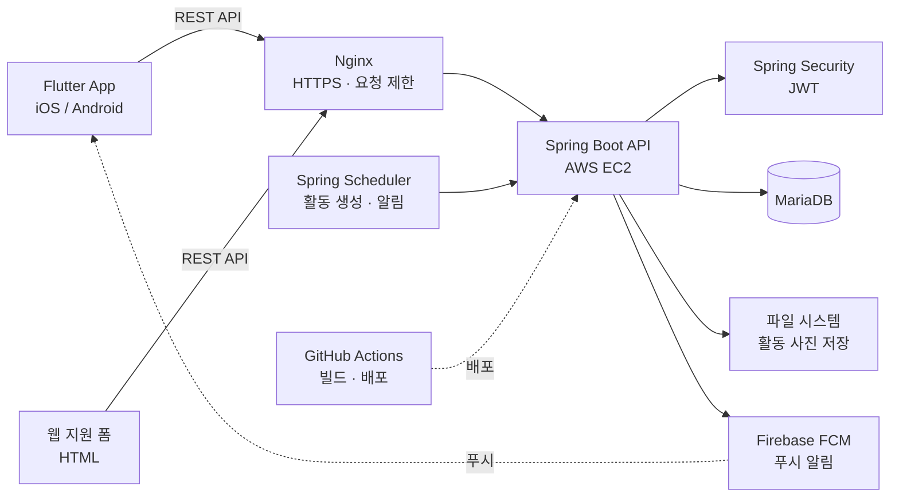

# 🏸 SMASH
**배드민턴 동아리 운영진의 반복 업무를 자동화하고, 흩어진 데이터를 중앙화하는 올인원 운영 관리 플랫폼**

---

<p align="center">


</p>

## 📌 Project Overview

SMASH는 대학교 배드민턴 동아리 운영 과정에서 겪은 비효율적인 수작업을 해결하기 위해 기획된 운영 관리 서비스입니다. 기존의 분산된 도구(카카오톡, 엑셀, 구글 폼)를 통합하여 운영자는 효율적인 관리를, 부원은 편리한 참여를 할 수 있는 환경을 구축합니다.

> 동아리 부회장으로 2년간 직접 운영하며 느낀 불편함을 기반으로 기획 · 설계 · 개발 · 배포 · 운영까지 전 과정을 혼자 진행한 개인 포트폴리오 프로젝트입니다.

### 🔄 AS-IS vs TO-BE

| 구분 | 도입 전 (AS-IS) | SMASH 도입 후 (TO-BE) |
| --- | --- | --- |
| **운영 데이터** | 카카오톡, 엑셀, 구글 폼 분산 | **중앙 데이터베이스 통합 관리** |
| **조 배정** | 수동 작성 및 수작업 공유 | **가능 요일 기반 자동 배정 알고리즘** |
| **출석 집계** | 엑셀 수기 관리 및 누락 위험 | **이월 시스템 자동 계산 및 시각화** |
| **공지/투표** | 단체 채팅방 텍스트 공지 | **앱 내 실시간 투표 + 푸시 알림** |
| **이동 조율** | 카카오톡으로 수동 파악 | **같이/따로 선택 + 택시 그룹 자동 배정** |
| **신입 모집** | 구글 폼 + 수동 등록 | **웹 지원 폼 + 합격 시 자동 등록** |
| **활동 사진** | 단체 채팅방에 산재 | **활동별 업로드, 모아보기, 원본 갤러리 저장** |
| **정보 접근성** | 운영진만 확인 가능 | **부원 본인의 활동 내역 직접 확인** |

---

## 🎯 Core Features

### ✅ v1 — 핵심 운영 기능

#### 🗳️ 일일 활동 투표 시스템
- 평일 자정(0시) 스케줄러가 당일 활동을 자동 생성 (Spring Scheduler)
- 부원은 정규참여 / 이월 / 타조참여 / 불참 중 선택
- 시간대별 투표 마감 자동 처리
- 서버 시작 시 당일 활동 누락 방지 (`@PostConstruct`)
- 선택 즉시 화면에 반영되는 낙관적 업데이트 (실패 시 롤백)

#### 🔄 출석 이월(Carry-over) 시스템
- 동아리 고유 운영 규칙 반영: 월 보장 활동 횟수 내에서 다른 날짜로 이월 가능
- 이월 대상 후보 자동 계산 및 충족 여부 집계
- 이월 취소 시 기록 삭제 및 자동 복구

#### 👥 조 편성 및 자동 배정
- 부원의 가능 요일을 수집해 그리디 알고리즘으로 조 자동 배정
- 배정 미리보기 → 개별 수동 조정 → 확정의 3단계 프로세스
- 미배정자 개별 수동 배정 지원
- 새 학기 초기화: 조 배정·가용 시간·조장/부조장을 한 번에 해제

#### 🏖️ 자유활동 기간 관리
- 시험기간 등 자유활동 기간을 다건 등록/삭제 가능
- 겹치는 기간 등록 시 서버에서 자동 거부
- 스케줄러가 자유활동 기간 여부를 확인해 `FREE` 타입으로 활동 자동 생성

#### 🎟️ 가입 코드 시스템
- 임원이 사전 등록(PENDING) → 부원이 가입코드로 직접 가입(ACTIVE) 전환
- 학기당 1개 코드 관리, 활성/비활성 토글, 재발급 지원
- 클립보드 복사 버튼으로 카카오톡 공유 편의성 제공
- 불합격(REJECTED) 처리된 학번은 가입코드가 있어도 가입 불가

#### 📊 출석 현황 대시보드
- 조별 참여 현황, 미달자, 타조 참여 현황 3가지 탭으로 시각화

---

### ✅ v2 — 운영 편의 기능 확장

#### 🚕 이동 조율 시스템
- 활동 참여 시 이동 방법 선택 (같이/따로)
- 임원 전용 택시 그룹 배정 화면
  - 상단 호차 카드 선택 → 하단 명단에서 탭하여 즉시 배정
  - 정원 4명 제한, 호차 변경 시 확인 다이얼로그
- 부원 홈 화면에서 내 호차 및 동승자 확인
- 택시비 정산 (결제자가 금액 입력 → N빵 자동 계산, 토스 딥링크 송금)

#### 🗳️ 일반 투표 시스템
- 임원이 회식/MT/자체대회 등 자유 주제로 투표 생성
- 익명/기명, 마감 시간 설정 또는 수동 종료 선택 가능
- 진행 중 / 종료된 투표 탭 구분, 투표 취소 후 재투표 지원
- 투표 등록일 및 마감일 표시

#### 💰 회비 관리
- 조별 탭으로 부원 납부 현황 확인
- 체크박스로 납부/취소 처리 (낙관적 업데이트, 부원별 중복 탭 방지)
- 전체 납부 진행률 시각화, 학기 종료 시 전체 초기화

#### 📋 동아리 지원 폼 시스템
- 임원이 앱에서 질문 추가/삭제/순서 변경 (TEXT/MULTILINE/SELECT 타입)
- 지원 기간 설정 (시작일시 ~ 마감일시), 폼 활성/비활성 토글
- 웹 지원 폼 (`apply.html`, 인증 불필요)
  - 고정 항목: 이름, 학번, 학과, 전화번호
  - 커스텀 질문: 임원이 추가한 질문들
  - 희망 활동 시간 선택 (요일/시간대)
  - QR코드로 접근 가능
- 중복 지원 방지 (학번 기준)
- 합격 처리 시 users 테이블 자동 등록 + member_availability 자동 등록
- 전체 합격 처리 (미처리 지원자 일괄 합격)
- 불합격 처리 / 불합격 취소
- 지원서 메모 타임라인 (임원 공유 메모)
- 엑셀 내보내기 (Apache POI)

#### 👤 부원 관리 강화
- 부원 상세 다이얼로그 (이름/학과/학번/전화번호/조/권한)
- 학과/전화번호 수정, 복사 기능
- 조 변경, MEMBER ↔ ADMIN 권한 변경
- 임원별 개인 메모 타임라인 (공유 X)
- 부원 탈퇴 처리
- 조 편성 테이블 UI (조장/부조장/부원 한눈에 확인)
- 부조장 지정/해제 기능
- 자동 배정 대상에 PENDING 부원 포함

#### 📸 활동 사진 관리
- 임원이 활동별 사진 업로드 (원본 그대로 저장)
- 2열 그리드 형태로 사진 목록 표시
- 사진 탭 → 전체화면 보기 (핀치 줌 지원)
- 전체화면에서 **원본 사진을 갤러리(SMASH 앨범)에 저장**
- 사진 길게 누르기 → 삭제
- 과거 활동 사진도 조회 가능
- 사진 파일 접근은 임원 로그인 토큰이 있어야만 가능

#### ⚙️ 설정 페이지
- 내 정보 확인, 비밀번호 변경 (영문/숫자/특수문자 8자 이상)
- 앱 버전 정보, 로그아웃, 회원 탈퇴

---

### ✅ v3 — 운영·안정화

#### 🔔 푸시 알림 (Firebase FCM)
- 활동 시작 1시간 전, 아직 참여 여부를 선택하지 않은 부원에게 마감 임박 알림 (매 정각 스케줄러)
- 새 투표 생성 알림, 택시비 정산 알림
- 사용자별 알림 수신 설정(켜기/끄기)
- iOS(APNs) / Android 토큰 등록 및 갱신 처리

#### 📅 캘린더
- 월별 활동·일정 조회, 임원이 일정 등록/삭제

#### ⚡ 시작 성능 개선
- 자동 로그인 후 홈 화면 진입까지 약 4.5초 → **275ms**
- 단계별 계측으로 원인이 앱 초기화가 아닌 서버 접속 경로(TLS 핸드셰이크)임을 확인
- 자세한 과정은 아래 트러블슈팅 참고

#### 🙋 회원 탈퇴 (앱 안)
- 설정 → 회원 탈퇴, 비밀번호 재확인 후 즉시 처리
- 개인 정보는 삭제하거나 식별할 수 없는 값으로 대체하고, 참여·회비·정산 기록은 익명 상태로 보관 (다른 부원의 기록 유지)
- 마지막 임원은 탈퇴 불가, 비밀번호 오류에는 로그인과 같은 횟수 제한 적용
- 삭제 요청 안내 페이지: `https://cju-smash.duckdns.org/delete-account.html`

#### 🛡️ 사용 편의·안정성 개선
- 임원 홈 화면에 운영 메뉴 버튼 추가 (Android 제스처 내비게이션에서 가장자리 스와이프가 뒤로가기와 겹치는 문제 대응)
- 로그인·탈퇴·정산 생성 시 네트워크 오류를 구분해 안내
- 정산 생성 중복 탭 방지, 이미 생성된 정산이면 기존 정산을 불러와 표시

---

## 🔐 Security

| 항목 | 내용 |
| --- | --- |
| **인증** | JWT Access(30분) / Refresh(180일) 토큰, `typ` 클레임으로 종류 구분, Refresh Token은 SHA-256 해시로 저장 |
| **인가** | MEMBER / ADMIN 역할 분리, Spring Security로 경로별 접근 제어. 미인증 요청은 401로 응답해 클라이언트가 자동 갱신 가능 |
| **IDOR** | 정산 API에서 소유권·멤버십 검증 |
| **파일 업로드** | 확장자가 아닌 매직 바이트로 이미지 형식 검증 (JPG/PNG/GIF/WEBP) |
| **사진 접근 제어** | `/files/photos/**`는 ADMIN 토큰 필요 |
| **무차별 대입 방어** | 학번별 로그인 실패 5회 시 10분 잠금(Spring) + IP별 요청 제한(Nginx) |
| **가입 우회 차단** | 불합격(REJECTED) 학번의 재가입 거부 |
| **참여 응답 검증** | 서버가 내려준 허용 버튼 목록을 참여 응답 API에서도 강제 (타 조 활동에 정규 출석 응답, 취소된 활동 응답 거부) |
| **민감 정보 암호화** | 정산 계좌번호를 AES-256-GCM으로 암호화 저장 (JPA 변환기), 키는 코드 밖 서버 설정에 보관, 기존 평문 데이터는 서버 시작 시 자동 이전 |
| **개인정보 삭제** | 앱 안 회원 탈퇴 시 비밀번호 재확인 → 개인정보 삭제·익명화, 결제자 계좌 정보 삭제, 지원서 개인정보 정리 |
| **배포 시크릿** | 서비스 계정 키는 GitHub Secrets에서 주입하고 배포 로그에는 출력하지 않음 |
| **전송 구간** | HTTPS(TLS), HTTP는 HTTPS로 리다이렉트 |
| **공개 범위 축소** | 운영 환경에서 Swagger 비활성화, 8080 직접 접근 차단, SSH 비밀번호 로그인 차단 |

---

## 🛠 Tech Stack

| 분류 | 기술 |
| --- | --- |
| **Frontend** | Flutter 3, Riverpod, Dio, go_router, flutter_secure_storage, qr_flutter, flutter_file_saver, image_picker, gal, firebase_messaging |
| **Backend** | Java 21, Spring Boot 3.5, Gradle, Spring Security, JWT, Spring Scheduler, Apache POI, Firebase Admin SDK |
| **Database** | MariaDB (MySQL 호환) |
| **Infra** | AWS EC2 (Ubuntu, 서울), Nginx 리버스 프록시, Let's Encrypt(HTTPS), DuckDNS, systemd 자동 시작 |
| **CI/CD** | GitHub Actions (main push → 빌드 → 배포) |
| **Test** | JUnit5, Mockito, AssertJ, H2 (인메모리) |
| **Design** | Pretendard 폰트, 자체 디자인 시스템 (AppColors, AppTheme) |

---

## 🧰 Development Tools
- Claude AI (기획 · 설계 · 개발 전반)
- IntelliJ IDEA (백엔드)
- Android Studio / Xcode (Flutter 빌드·배포)
- Git / GitHub (모노레포)

---

## 🏗 Architecture



---

## 📁 Project Structure

```
smash/
├── backend/app/
│   └── src/main/java/com/smash/
│       ├── api/
│       │   ├── auth/          (로그인·가입·탈퇴: AuthService, WithdrawalService)
│       │   ├── activity/      (ActivityPhotoController, ActivityPhotoService)
│       │   ├── attendent/
│       │   ├── group/
│       │   ├── invite/
│       │   ├── schedule/      (정규 일정, 캘린더)
│       │   ├── assignment/
│       │   ├── poll/
│       │   ├── dues/
│       │   ├── transport/     (이동 조율, 택시비 정산)
│       │   ├── application/
│       │   ├── fcm/           (푸시 토큰, 알림 설정)
│       │   └── admin/
│       ├── domain/
│       │   ├── user/          (User, MemberNote, UserNotificationSetting)
│       │   ├── activity/      (Activity, ActivityPhoto)
│       │   ├── group/
│       │   ├── invite/
│       │   ├── participation/
│       │   ├── availability/
│       │   ├── poll/
│       │   ├── dues/
│       │   ├── transport/
│       │   ├── application/
│       │   ├── schedule/
│       │   └── token/
│       ├── common/
│       │   ├── crypto/        (FieldCrypto, AccountNumberConverter)
│       │   ├── exception/
│       │   └── response/
│       ├── scheduler/
│       ├── auth/              (JwtProvider, LoginAttemptService)
│       └── config/
│
├── frontend/app/
│   └── lib/
│       ├── core/
│       │   ├── api/
│       │   ├── storage/
│       │   ├── theme/
│       │   └── constants/
│       └── features/
│           ├── auth/
│           └── home/
│
├── .github/workflows/         (deploy.yml)
└── docs/
```

---

## 🗄 ERD (27개 테이블)

```
users ──── participation ──── activity ──── club_groups
   │                            │              │
   ├── member_availability      ├── activity_photo
   ├── member_note              └── activity_schedule
   ├── refresh_token
   ├── fcm_token
   └── user_notification_setting

polls ──── poll_options ──── poll_votes

transport_group ──── transport_member
taxi_settlement ──── taxi_settlement_payment

application_form ──── form_question
application ──── application_answer
            └── application_memo

schedule(캘린더) / dues_payment / invite_code / free_period
```

---

## 📱 화면 구성

### 공통 (하단 바)
| 탭 | 내용 |
| --- | --- |
| 홈 | 오늘 활동 카드 (이동방법 선택/내 호차 확인) + 진행 중인 투표 카드 |
| 투표 | 진행 중 / 종료된 투표 탭 구분, 등록일/마감일 표시 |
| 캘린더 | 월별 활동·일정 |
| 더보기 | 설정 페이지 연결 (비밀번호 변경, 알림 설정, 로그아웃, 회원 탈퇴) |

### 임원 전용 Drawer (8개 메뉴)
홈 화면 왼쪽 위 메뉴 버튼 또는 왼쪽 가장자리 스와이프로 열 수 있습니다.

| 메뉴 | 기능 |
| --- | --- |
| 지원 폼 관리 | 질문 추가/삭제/순서 변경, 기간 설정, QR코드 |
| 지원서 관리 | 지원서 목록/상세, 메모, 합격/불합격/전체합격, 엑셀 내보내기 |
| 회비 관리 | 조별 납부 현황, 체크박스 처리, 초기화 |
| 가입코드 관리 | 발급, 재발급, 활성/비활성 토글, 복사 |
| 부원 관리 | 부원 목록/상세/수정/탈퇴, 조변경/권한변경/개인메모, 조 편성 테이블, 자동 배정, 새 학기 초기화 |
| 정규활동 일정 | 요일별 활성/비활성 스위치 |
| 날짜별 활동 관리 | 활동 취소/복구, 자유활동 전환, 활동 사진 관리 |
| 자유활동 기간 설정 | 기간 다건 등록/삭제, 겹침 검증 |

---

## 🚀 Infra & Deployment

- **서버**: AWS EC2 (Ubuntu, 서울 리전), Spring Boot JAR을 systemd 서비스로 실행
- **DB**: MariaDB (MySQL 호환)
- **HTTPS**: Nginx 리버스 프록시 + Let's Encrypt 인증서(자동 갱신), DuckDNS 도메인
- **배포**: GitHub Actions — main 브랜치 push 시 빌드 후 EC2에 배포하고 서비스 재시작
- **설정 분리**: 운영 설정(DB 접속 정보, JWT 시크릿, 암호화 키, 업로드 경로 등)은 코드 저장소 밖의 서버 설정 파일에서 읽음
- **웹 지원 폼**: `https://cju-smash.duckdns.org/apply.html`
- **개인정보 문서**: `https://cju-smash.duckdns.org/privacy.html` (처리방침), `.../delete-account.html` (삭제 안내)
- **요청 제한**: Nginx에서 로그인·가입 요청을 IP당 분당 10회로 제한
- **사진 저장 경로**: `/home/ubuntu/smash-files/photos/{activity_id}/`
- **앱 배포**: iOS는 TestFlight, Android는 Play 스토어 내부 테스트 트랙 (업로드 키 서명, Firebase 연동)

---

## 🐛 주요 트러블슈팅

### 앱 시작 지연 — 추측 대신 측정으로 원인 찾기
**문제**: 자동 로그인 후 홈 화면이 뜨기까지 약 4.5초 소요
**분석**: 시작 단계별로 시간을 측정하고 요청별 소요 시간을 기록. Firebase 초기화 등 앱 초기화는 합계 9ms로 병목이 아니었고, 지연은 서버 요청(TLS 핸드셰이크 중앙값 약 2.8초)에서 발생
**원인**: 서버를 Tailscale Funnel로 공개하던 접속 경로의 연결 수립 지연. 내부망에 연결된 PC에서 재면 이 지연이 보이지 않아(약 50ms) 처음에 잘못 판단했고, 공개 DNS를 직접 조회해 외부 사용자와 같은 조건으로 재측정해 확인
**해결**: Nginx 리버스 프록시 + Let's Encrypt로 직접 HTTPS 전환 (앱 코드는 주소 상수 한 줄만 변경)
**결과**: TLS 약 2.8초 → 약 0.02초, 홈 진입 전 인증 확인 4,565ms → 275ms (94% 감소)

### 서버 시간대(UTC) — 투표 마감이 어긋나는 문제
**문제**: 오후 2시가 지나면 마감되어야 하는 활동 투표가 마감되지 않음
**원인**: EC2 서버 시간대가 UTC여서 `LocalTime.now()`가 9시간 어긋남
**해결**: 애플리케이션 시작 시 `TimeZone.setDefault(Asia/Seoul)` 지정

### 외부 설정 파일 미반영 — 사진 업로드 실패
**문제**: 사진 업로드가 "업로드 실패"로만 응답, 서버 로그에는 원인이 보이지 않음
**원인**: 서버가 `--spring.config.location`으로 외부 설정 파일만 읽어 저장소의 `application.yaml`(업로드 용량 설정)이 적용되지 않았고, Spring 기본값 1MB 제한에 걸림. 업로드 폴더도 서버에 없었음
**해결**: 서버 설정 파일에 용량 제한 추가, 폴더 생성. 업로드 용량 초과 등 프레임워크 예외가 500으로 응답되던 전역 예외 처리도 405/404/413/400으로 정리

### 만료 토큰 재발급이 동작하지 않던 문제
**문제**: Access Token 만료 후 자동 갱신이 되지 않고 로그아웃됨
**원인**: 미인증 요청에 Spring Security 기본 응답이 403이어서 클라이언트의 401 기반 갱신 로직이 실행되지 않음. 동시에 여러 요청이 갱신을 중복 호출하는 문제도 있었음
**해결**: 인증 진입점을 401로 설정, 클라이언트에서 갱신 요청을 하나로 합치고(single-flight) 4xx일 때만 토큰을 삭제하도록 수정

### 동시 중복 요청 — 정산 생성이 성공했는데 실패로 표시됨
**문제**: 정산 시작 버튼을 빠르게 두 번 누르면 정산은 만들어졌는데 앱에는 "생성 실패"가 표시됨
**원인**: 서버의 중복 검사를 두 요청이 동시에 통과한 뒤, 두 번째 요청이 DB 유니크 제약(호차당 정산 1건)에 걸려 500 오류로 응답
**해결**: 제약 위반을 `ALREADY_EXISTS`(409)로 변환하는 서버 처리 + 앱에서 요청 중 버튼 비활성화, 409면 기존 정산을 불러와 표시. 단위 테스트로 검증

### 민감 정보 평문 저장 — 정산 계좌번호 암호화
**문제**: 계좌번호가 DB에 평문으로 저장되어 DB 백업 유출 시 그대로 노출
**해결**: JPA `AttributeConverter`로 AES-256-GCM 암호화(저장)/복호화(조회)를 투명하게 적용해 서비스 코드는 변경하지 않음. `enc:` 접두사로 암호문과 기존 평문을 구분해, 서버 시작 시 평문 행만 골라 암호화하는 멱등 이전 작업을 추가. 키가 없으면 서버가 시작되지 않게 해 평문 저장 사고를 방지. 백업 후 배포하고 DB에서 암호문 저장 확인

### 회원 탈퇴 설계 — 물리 삭제 대신 익명화
**문제**: 사용자를 참조하는 테이블이 14개라 사용자를 삭제하면 외래 키 제약으로 실패하고, 삭제하더라도 다른 부원의 출석·정산 기록이 깨짐 (기존 임원용 삭제 기능도 활동 이력이 있는 부원에서는 실패)
**해결**: 개인정보(이름·학번·전화번호·비밀번호·토큰·알림 설정·메모·결제 계좌)는 삭제하거나 대체 값으로 익명화하고, 활동·정산 기록은 익명 사용자에 연결해 보존. 학번은 `withdrawn-{id}`로 바꿔 같은 학번을 다시 등록할 수 있게 함. 비밀번호 재확인, 마지막 임원 보호, 횟수 제한을 적용하고 시나리오별 단위 테스트로 검증

### JPA N+1 문제 해결
**문제**: 오늘 활동 목록 조회 시 활동 수에 비례해 쿼리가 2N+1번 발생
**해결**: `@EntityGraph`로 group을 JOIN 조회, Participation은 IN 쿼리로 일괄 조회 후 Map으로 변환
**결과**: 쿼리 수 2N+1 → 3번(고정)으로 개선

### boolean vs Boolean — Jackson 역직렬화 버그
**문제**: 가입코드 활성화/비활성화 토글이 항상 `false`로만 처리되는 버그
**원인**: `boolean` primitive 타입에서 Lombok이 생성하는 getter 이름이 `setActive()`가 되어 Jackson이 `setIsActive()`를 찾지 못함
**해결**: `boolean` → `Boolean` 래퍼 클래스로 변경

### isActive 직렬화 — Jackson boolean getter 네이밍 버그
**문제**: 서버 응답에서 `isActive`가 `active`로 내려와 Flutter에서 파싱 실패
**해결**: `@JsonProperty("isActive")`를 명시한 getter를 직접 작성

### Enum 충돌 — java.time.DayOfWeek vs 커스텀 DayOfWeek
**문제**: 지원 폼 제출 시 `"MON"` 값이 Java 표준 `DayOfWeek`로 역직렬화되어 파싱 실패
**해결**: import를 `com.smash.domain.group.DayOfWeek`로 변경

### 외래 키 제약 — 지원자 삭제
**문제**: users 삭제 시 member_availability 외래 키 제약으로 실패
**해결**: 연관 테이블 순서대로 삭제 후 users 삭제

### @Transactional 누락 — 회원가입 DB 미반영
**문제**: 가입코드로 회원가입 시 성공 응답은 오지만 DB에 반영되지 않음
**원인**: `signup()` 메서드에 `@Transactional` 누락으로 JPA 더티 체킹 미작동
**해결**: `@Transactional` 추가

### 회비 체크박스 중복 탭 문제
**문제**: 체크박스를 빠르게 두 번 탭하면 상태가 꼬이는 문제
**원인**: 낙관적 업데이트 중 중복 API 요청 발생
**해결**: 부원별 `_processingIds` Set으로 처리 중인 부원만 선택적으로 비활성화

---

## 🔮 추후 계획

### 배포 및 인프라
- Google Play 정식 출시 (내부 테스트 배포 완료)
- 활동 사진 **AWS S3 마이그레이션** 및 썸네일 생성
- DB 분리 (RDS) 검토

### 보안·품질
- 임원용 부원 삭제 기능을 탈퇴 로직(익명화)으로 통일
- 탈퇴 시 당일·미래 활동의 참여 기록과 호차 배정 정리
- 에러 코드 문자열을 상수로 관리 (오타를 컴파일 단계에서 방지)
- 로그인 잠금 해제 시간 검증을 위한 `Clock` 주입 및 테스트 확대

---

## 🚀 Development Status

**v1 (완료)**
- [x] 서비스 기획 및 요구사항 정의
- [x] ERD 설계 및 API 설계, 개발 (Spring Boot)
- [x] Flutter 앱 개발
- [x] 디자인 시스템 적용 (Pretendard, AppTheme)
- [x] JUnit5 + Mockito 단위/통합 테스트
- [x] N+1 문제 해결 (@EntityGraph + IN 쿼리)

**v2 (완료)**
- [x] 일반 투표 기능, 회비 관리, 이동 조율, 택시비 정산
- [x] 동아리 지원 폼 시스템 (웹 폼 + QR코드 + 엑셀 내보내기), 지원서 메모
- [x] 부원 상세·조 편성 테이블·부조장 지정
- [x] 활동 사진 업로드/조회/삭제 (원본 저장)
- [x] 설정 페이지, Drawer 메뉴 정리

**v3 (완료)**
- [x] Raspberry Pi → **AWS EC2 이전**
- [x] **CI/CD 파이프라인** (GitHub Actions)
- [x] **Push Notification** (FCM, 마감 임박·새 투표·정산 알림, 수신 설정)
- [x] **TestFlight 배포**, Android Play 내부 테스트 배포
- [x] 직접 HTTPS 전환 및 **시작 성능 개선** (4.5초 → 275ms)
- [x] 보안 강화 (사진 접근 제어, 로그인 시도 제한, Swagger 비공개, 재가입 우회 차단)
- [x] 캘린더, 새 학기 초기화, 활동 사진 원본 갤러리 저장
- [x] 낙관적 업데이트 (투표·이동 방법)
- [x] 정산 계좌번호 암호화(AES-256-GCM), 참여 응답 서버 검증
- [x] 앱 안 회원 탈퇴, 삭제 안내 페이지, 개인정보처리방침 갱신
- [x] 정산 생성 중복 방지, 네트워크 오류 안내, 임원 메뉴 버튼

**현재 규모**: 테이블 27개 · API 101개 · 테스트 96개

**진행 예정**
- [ ] Google Play 정식 출시
- [ ] 사진 S3 이전 및 썸네일
- [ ] 실제 동아리 배포 후 피드백 기반 개선

---

## 👨‍💻 Developer

**김동현** · GitHub: [@kor-BaKi](https://github.com/kor-BaKi)

> 배드민턴 동아리 운영 경험을 바탕으로 문제 정의부터 서비스 설계, 개발, 배포, 운영까지 전 과정을 진행한 개인 프로젝트입니다.

**담당 영역**
- 서비스 기획 및 사용자 흐름 설계
- ERD 및 API 설계
- 백엔드 개발 (Spring Boot)
- 프론트엔드 개발 (Flutter)
- 디자인 시스템 구축
- 인프라 구성·배포·운영 (AWS EC2, Nginx, GitHub Actions)